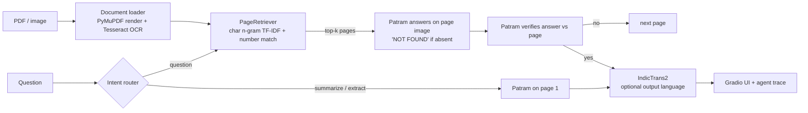

# Indian Document Understanding Tool

Upload an Indian-language notice, form or government document (PDF or image), then **extract fields,
summarise it, and ask questions about it** in Hindi or English, with answers optionally translated into
12 Indian languages. Built on **BharatGen Patram-7B-Instruct** (document vision-language model) and
**AI4Bharat IndicTrans2** (translation), with a retrieval + self-verification loop for multi-page documents.

## Architecture



The QA path is a small **retrieve → answer → verify → retry** agent loop (`src/idu/pipeline.py`).
Every step is returned as a trace and shown in the UI.

## Models and why

| Role | Model | Why |
|---|---|---|
| Document VQA / extraction / summary | `bharatgenai/patram-7b-instruct` | Trained on Indian documents; strong on DocVQA-style benchmarks for its size. Gated repo (request access). |
| Translation | `ai4bharat/indictrans2-{indic-en,en-indic}-1B` | Open, covers all 22 scheduled languages. |
| Page retrieval | char n-gram TF-IDF + exact-number matching | Script-agnostic, no extra model; handles identifiers and table continuation pages. Dense multilingual embedders can replace it behind `PageRetriever.top_k`. |
| OCR (retrieval index only) | Tesseract `hin`/`mar`/… packs | Government PDFs often have corrupt text layers (see Limitations). |

## Quick start (Google Colab)

1. Request access to [Patram](https://huggingface.co/bharatgenai/patram-7b-instruct) and create a *read* token.
   Add it as a Colab secret named `HF_TOKEN` (key icon → *Notebook access* on).
2. Open `notebooks/colab_run.ipynb`, set the runtime to **GPU (T4 is enough; 4-bit is automatic)** and run the cells.
   It installs dependencies, runs the unit tests, launches the Gradio app, and runs the evaluation.

Local (needs an NVIDIA GPU and `tesseract-ocr` + `tesseract-ocr-hin`):

```bash
pip install -r requirements.txt
export HF_TOKEN=hf_...
python app.py --share          # add --no-translate to skip loading IndicTrans2
pytest -q                      # 27 tests, no GPU or models needed
```

## Repository layout

```
app.py                  Gradio front-end (Extract & summarise | Ask the document)
src/idu/
  models.py             PatramVLM, IndicTrans2 Translator, HF login
  documents.py          PDF/image loading, page rendering, OCR / text-layer page text
  retrieval.py          PageRetriever
  pipeline.py           extraction, summary, agentic QA loop, intent router
  metrics.py            normalisation, EM / ANLS / token-F1, bootstrap CI
  failure.py            automatic failure taxonomy
eval/
  testcases.jsonl       starter test cases (see eval/README.md)
  run_eval.py           runs metrics + writes failure_analysis.md
  csv_to_jsonl.py       label cases in a spreadsheet, convert to JSONL
tests/                  unit tests (metrics, failure tags, retrieval, agent loop, harness)
notebooks/colab_run.ipynb
data/samples/           4 public sample documents (Hindi, Kannada, Marathi, Telugu)
```

## Evaluation

See [`eval/README.md`](eval/README.md) for the case format, coverage targets and labelling rules.

```bash
python eval/run_eval.py --out eval/results/run1
python eval/run_eval.py --out eval/results/run1_goldpage --gold-page
python eval/run_eval.py --out eval/results/run1_noverify --no-verify
```

**Status of the test set:** 50 draft cases (48 QA + 2 extraction cases, which score 11 field rows) over
**4 public documents in 4 languages** (Hindi Gazette, Kannada and Telugu radio bulletins, Marathi police
circular/resolution). Labels were drafted from the page images and are marked `"label_status": "draft"`:
check each against the page and change it to `verified`. Four documents is below the recommended 8–12, so add
more (forms, certificates, Tamil/Bengali) before reporting results.

### Results

Fill in after running on your final test set (no numbers are reported here because none were measured yet):

| Setting | n | EM | ANLS | token-F1 | retrieval hit |
|---|---|---|---|---|---|
| Full pipeline (retrieve + verify) | | | | | |
| Gold page (VLM only) | | | | | |
| No verification | | | | | |

### Failure analysis

`failure_analysis.md` (generated per run) groups errors with a heuristic taxonomy:
`RETRIEVAL_MISS`, `EMPTY_OR_NOT_FOUND`, `WRONG_LANGUAGE_OR_SCRIPT`, `NUMERIC_MISSING`, `NUMERIC_WRONG`,
`NEAR_MISS_CHAR_ERROR`, `PARTIAL_ANSWER`, `EXTRA_TEXT`, `WRONG_ANSWER`, with worst examples per tag and
breakdowns by language, document type and question type. The tags are automatic suggestions: read the
examples and write your own conclusions in the "Manual analysis" section.

## Rubric mapping

| Criterion | Where |
|---|---|
| Problem definition & relevance | Section above; Indian government documents are multilingual, scanned, table-heavy |
| Model / dataset selection | "Models and why"; public Gazette documents as test data (`eval/README.md`) |
| Working end-to-end application | `app.py` (upload → extract / summarise / ask → translated answer) |
| GenAI / RAG / agentic integration | VLM + page retrieval (RAG) + retrieve-answer-verify-retry loop + intent router (`pipeline.py`) |
| Quantitative testing & error analysis | `eval/run_eval.py`, `metrics.py`, `failure.py`, generated `failure_analysis.md` |
| Demo, documentation & repository | This README, Colab notebook, tests; push with the commands below |

## Limitations (known)

- **Untested end-to-end in the build environment:** the Patram and IndicTrans2 code paths and Tesseract Hindi OCR
  were written against the model cards but could not be run where this repo was assembled (no GPU, no Hindi OCR
  data). The retrieval, agent loop, metrics, failure tagging, evaluation harness and Gradio UI construction are
  covered by unit tests. Expect to fix small issues on the first Colab run (Patram's remote code API may change).
- **Text layers can be wrong.** In the sample Gazette, the embedded text reads `रािमागग` for `राजमार्ग`, so
  retrieval uses OCR pages and only falls back to the text layer (with a warning in the UI).
- **Retrieval weights were set after looking at the Gazette sample.** Using only the PDF text layer (no OCR),
  top-2 page retrieval found the labelled page for 39 of 48 questions: Gazette 17/18, Telugu bulletin 11/12,
  Kannada bulletin 8/10, Marathi circular 3/8. The Marathi misses are expected: its first two pages are camera
  scans with no text layer, so they are only retrievable with OCR. The Kannada layer is also partly garbled.
  Measure retrieval again with OCR enabled and on new documents before quoting a number.
- Cross-lingual retrieval (English question, Hindi page) is weak with TF-IDF; use a multilingual embedder if needed.
- Language detection is script-level (all Devanagari → Hindi); translation can corrupt names and numbers, so
  evaluation compares answers without translation.

## Publish to GitHub

```bash
cd indian-doc-understanding
git init && git add . && git commit -m "Indian Document Understanding Tool"
git branch -M main
git remote add origin https://github.com/<your-username>/indian-doc-understanding.git
git push -u origin main
```

## License

MIT for the code. Models and the sample document have their own licenses / terms.
